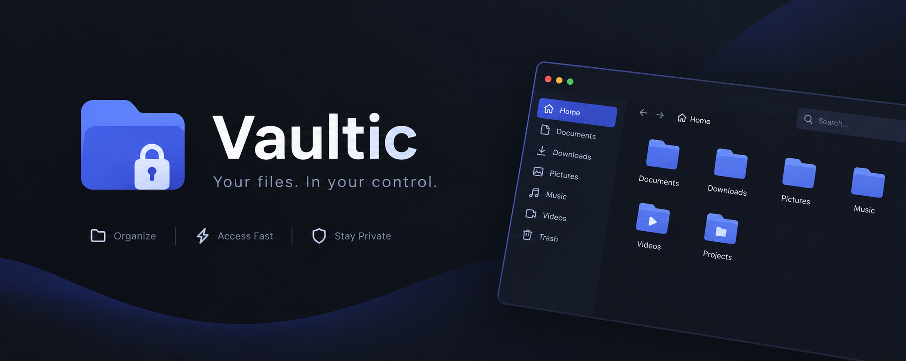

# Vaultic

Vaultic is a desktop file manager that is written in  Go and Fyne to feature easy browsing and management of files. Its features include folder navigation, tabs, and more.

## Features

- **Folder navigation**:  Browse directories and navigate between folders.
- **Tabbed browsing**:  Work with multiple directories in separate tabs.
- **Sidebar shortcuts**:  Quickly access common locations like Home, Desktop, Downloads, and Documents.
- **File information**:  View file names and sizes.
- **Sorting**:  Keep folders grouped before files and sort items alphabetically.
- **File opening**:  Open files using their default Windows applications.
- **Context menu**:  Access useful actions directly from files and folders.
- **Path navigation**:  Navigate to directories by entering their paths.

**Tech Stack**
 - [Go](https://go.dev/)
 - [Fyne](https://fyne.io/) 

**Requirements**
- Go
- GCC and the required Fyne build dependencies for Windows

## Performance

Vaultic is usable, but in terms of performance its not that perfect yet. So ill be trying to optimise it more and more.

Suggest features, report bugs and also contribute if you want. If you have some ideas regarding Vaultic, let me know.
