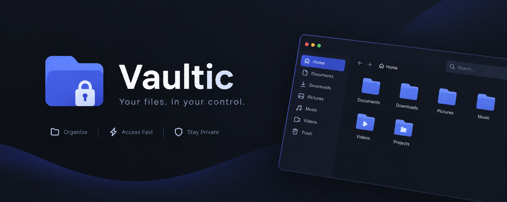

# Vaultic




**A simple, modern file manager for Windows.**

Vaultic is a desktop file manager that has been developed using Go and Fyne to facilitate easy browsing and management of files. Its functions include folder navigation, tabs, file management tools and more.

> **Note:** Vaultic is still under development. The application does not have better speed performance compared to other existing file managers, and it is one of the things I hope to address in future development phases.

## Features

- **Folder navigation** — Browse directories and navigate between folders.
- **Tabbed browsing** — Work with multiple directories in separate tabs.
- **Sidebar shortcuts** — Quickly access common locations like Home, Desktop, Downloads, and Documents.
- **File information** — View file names and sizes.
- **Sorting** — Keep folders grouped before files and sort items alphabetically.
- **File opening** — Open files using their default Windows applications.
- **Context menu** — Access useful actions directly from files and folders.
- **Path navigation** — Navigate to directories by entering their paths.

## Built With

- [Go](https://go.dev/) — Application logic
- [Fyne](https://fyne.io/) — Desktop GUI framework

## Getting Started

### Download

Download the latest `Vaultic.exe` from the project's [Releases](../../releases) page, when available.

### Run from source

**Requirements**
- Go
- GCC and the required Fyne build dependencies for Windows

Clone the repository:

```bash
git clone https://github.com/codedbyryuk/vaultic
cd vaultic
```

Run the application:

```bash
go run .
```

To build a standalone Windows executable:

```bash
go build -o Vaultic.exe .
```

The executable will be created in the project directory.

## Performance

Vaultic works well, but performance is something that's yet to be perfected. In any case, at the moment it is not better than the existing file manager programs. The future plans include discovering bottlenecks and optimizing directory load and render.

The goal is to make Vaultic not just usable, but also smooth and efficient.

## Roadmap

- [ ] Improve file browsing performance
- [ ] Optimise large-directory handling
- [ ] Refine the user interface
- [ ] Expand file management features
- [ ] Improve overall responsiveness

## Contributing

Suggestions, bug reports, and contributions are welcome. If you find a problem or have an idea for improvement, feel free to open an issue or submit a pull request.

---

*Vaultic is an independent project under active development.*